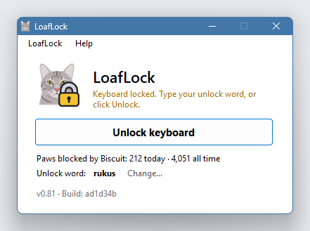
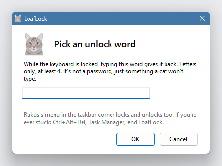
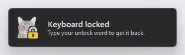
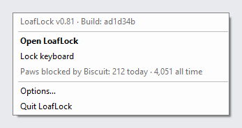
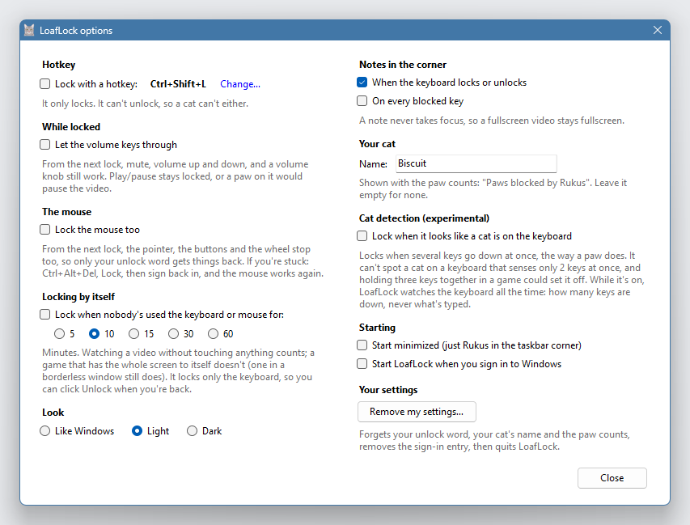
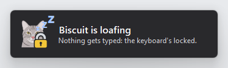
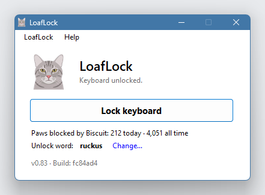
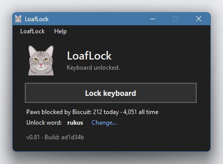
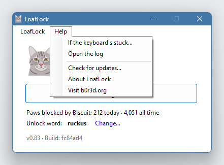

# LoafLock

Keeps a cat lying on the keyboard from typing. LoafLock sits in the Windows taskbar corner
as Ruckus. Lock the keyboard from there, and key presses go nowhere: the video keeps
playing and nothing gets typed. The mouse keeps working (or locks too, if you like).

Version 0.83, for Windows 10 and 11. Made by [b0r3d.org](https://b0r3d.org).



## Getting it

1. On the [Releases page](https://github.com/still-b0r3d/LoafLock/releases), download
   **LoafLock.exe**. It's one file and needs no installing. Put it wherever you like, a
   Tools folder or the Desktop.
2. Run it. Windows may show **"Windows protected your PC"**: click **More info**, then
   **Run anyway**. It says that about any program it hasn't seen much of yet that isn't
   code-signed, and LoafLock isn't. If you'd like to check the file first, its SHA-256 is
   in `LoafLock.exe.sha256` next to it, or build it yourself (below).

## Using it

1. The first time, LoafLock asks for an **unlock word**: letters only, at least 4, a word
   a cat won't type. It's not a password, just a cat filter.

   

2. Click **Lock keyboard**, in the LoafLock window or in Ruckus's menu (right-click him in
   the taskbar corner). He gets a gold padlock, and key presses go nowhere. A small note in
   the corner says so; it never takes focus, so a fullscreen video stays fullscreen.

   

3. To get the keyboard back, type your unlock word, or click **Unlock keyboard**. It can
   also unlock by itself once the cat's gone, or with the hotkey (both in Options).

Right-click Ruckus in the taskbar corner for his menu (you might need to click the **^** arrow
to see him):



Left-click Ruckus any time for the window: the paws blocked today and all time, and your
unlock word. **Options…** (in the window's LoafLock menu, or Ruckus's menu) has six pages,
listed down its left side. Apart from the note on locking and unlocking, every option is off
to start with, and in a row of choices the one LoafLock starts with says **(default)**, so a
change that didn't work out is easy to undo.



- **Locking**
  - **A hotkey** that locks: Ctrl+Shift+L unless you pick another. Tick **It unlocks too**,
    and pressing it again unlocks as well, as you let go. That only counts with just those
    keys down, and nothing else pressed before you let go, so a cat lying across the
    keyboard can't do it, but one that lands on exactly those keys could. A key on its own
    (Pause, Scroll Lock, F13 to F24) only ever locks: one paw could press it.
  - **Let the volume keys through** while locked: mute, volume up and down, a volume knob.
  - **Lock the mouse too**: the pointer, the buttons and the wheel stop as well, and only
    the keyboard gets things back (your unlock word, or the hotkey if it unlocks too).
- **By itself**
  - **Locking by itself** after 5 to 60 minutes with nobody using the keyboard or mouse.
    Watching a video without touching anything counts; a game that has the whole screen to
    itself doesn't (one in a borderless window still does). It locks only the keyboard, so
    whoever comes back can click Unlock.
  - **Unlocking by itself** once the cat's been gone for 30 seconds to 5 minutes (a minute
    to start with). Gone means nothing pressed or held down for that long, once the lock
    has blocked a paw: a lock you set before the cat comes stays on until it's been and
    gone. Your unlock word still works straight away. With locking by itself on as well,
    the page says what that means: after the cat's gone, the keyboard stays unlocked until
    nobody's used the PC for those minutes again.
- **Your cat**
  - **Your cat's name**, for "Paws blocked by Biscuit".
  - **Cat detection** (experimental): it locks when several keys go down at once, the way a
    paw does. To start with that's 4 together, 3 landing at the same moment, or 3 put down
    within a second and held for a second and a half, all held at least a quarter of a
    second. **Keys** (3 to 6) and **Held for** (0.1, 0.25 or 0.5 s) change those numbers:
    fewer keys or a shorter time spots more cats, and gives more false alarms. Shift, Ctrl,
    Alt and the Windows key don't count, so shortcuts never set it off. Keyboards differ in
    how many keys they can sense at once: at 4 keys it can't spot a cat on one that senses
    only 2 (some cheap keyboards and laptops); at 3 it can, but two keys held together in a
    game (W and A) set it off. Holding three keys together in a game (moving, jumping and
    strafing at once, say) could set it off at 4, unless the game has the whole screen to
    itself. It locks only the keyboard, the keys that set it off still get through, and the
    log says what it saw. While it's on, LoafLock watches the keyboard while unlocked too
    (see below).
- **Notes**: on locking and unlocking, or on every blocked key. When the cat's been lying on
  the keyboard for half a minute, Ruckus nods off in one: "Biscuit is loafing".\
  
- **Look**: like Windows, light or dark.
- **Starting**: **Start minimized**, **Start LoafLock when you sign in to Windows**, and
  **Remove my settings…**.

| Light | Dark |
|---|---|
|  |  |

From a shortcut, a script or a Stream Deck button:

```
LoafLock.exe lock      locks (and starts LoafLock first if it isn't running)
LoafLock.exe unlock    unlocks
```

Newer versions: **Help → Check for updates…** opens the Releases page.

## If you're ever stuck

- Type your unlock word, or click **Unlock keyboard** in the window or Ruckus's menu. If
  you ticked **It unlocks too**, the hotkey works as well.
- Press **Ctrl+Alt+Del**, click **Task Manager**, click **LoafLock**, click **End task**.
  The keyboard (and mouse) come back at once.
- With the mouse locked too: **Ctrl+Alt+Del**, **Lock**, then sign back in. The mouse
  works again, so you can click Unlock.

All of this is in the window's **Help** menu too.



## What it doesn't do

- It never connects to the internet: there's no network code in it at all.
- It never keeps what you type. The log (Help → Open the log) says when it locked and
  unlocked, never which keys.
- While unlocked, it doesn't look at the keyboard or the mouse at all, unless you turn on
  cat detection: then it watches how many keys are down at once and for how long, and
  forgets each one as it comes up.
- No admin rights, no services, no drivers. It writes only its own settings folder
  (`%APPDATA%\LoafLock`) and, if you tick it, one start-with-Windows entry.

## What it can't lock

- **Ctrl+Alt+Del and Windows+L** always work: Windows keeps them for itself, and they're
  the way out.
- **A window running as administrator** (an admin PowerShell, say): Windows keeps normal
  programs out of those, so keys typed into one can get through.
- **A key remapper** (PowerToys, AutoHotkey) started while locked can get ahead of
  LoafLock for up to a minute, and keys it remaps get through until then.
- **Laptop Fn keys** that the keyboard handles itself (brightness, airplane mode) never
  reach Windows, so they keep working.

## Removing it

**Options → Starting → Remove my settings…** clears its settings, its log and its start-with-Windows
entry, then quits. Then delete `LoafLock.exe`.

## Build it yourself

Nothing to install: `build.cmd` uses the C# compiler that comes with Windows
(.NET Framework 4.8).

```
build.cmd         builds bin\LoafLock.exe
build.cmd test    builds it and runs the tests
```

The tray icons are made from Ruckus by `tools\make-icons.ps1`, and the pictures here by
`bin\LoafLockTests.exe --screenshots docs\images` (windows pop up on the main screen for
about 15 seconds). What changed in each version is in [CHANGELOG.md](CHANGELOG.md).

## License

MIT, with the Commons Clause: free to use, change and share, but not to sell. See
[LICENSE](LICENSE).

---

Made by [b0r3d.org](https://b0r3d.org). Ruckus is b0r3d.org's cat.
