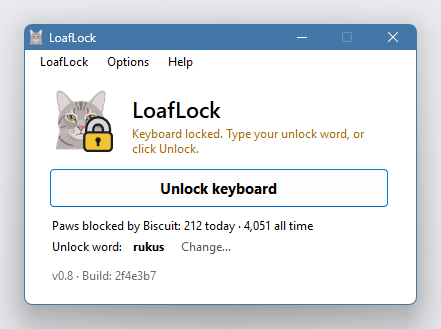
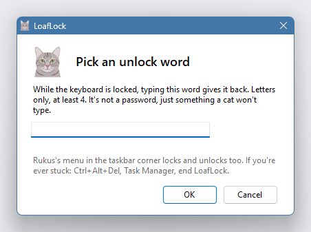
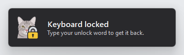
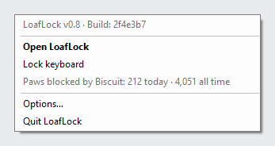
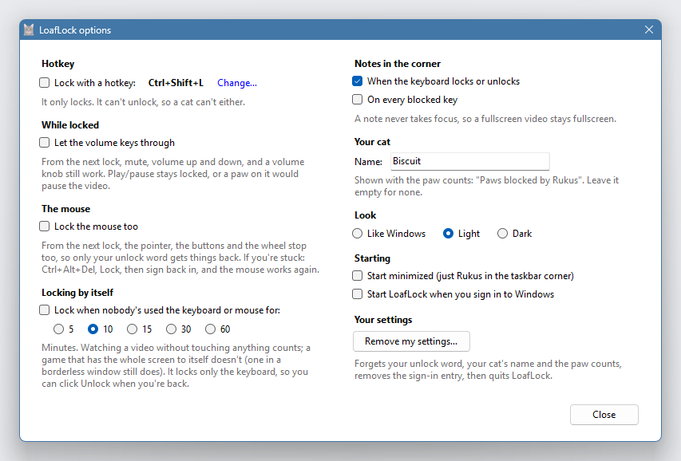
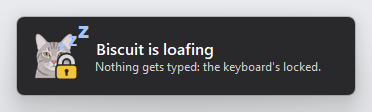
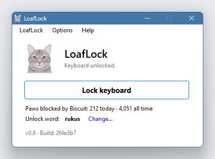
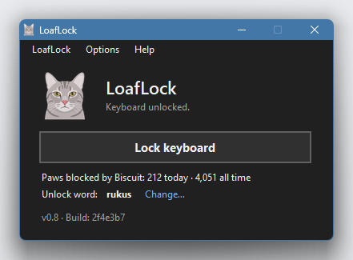
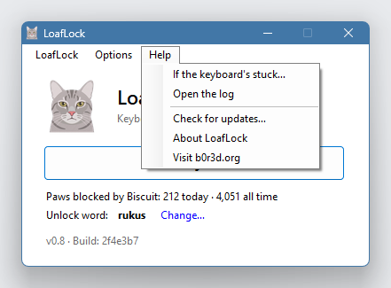

# LoafLock

Keeps a cat lying on the keyboard from typing. LoafLock sits in the Windows taskbar corner
as Rukus. Lock the keyboard from there, and key presses go nowhere: the video keeps
playing and nothing gets typed. The mouse keeps working (or locks too, if you like).

Version 0.8, for Windows 10 and 11. Made by [b0r3d.org](https://b0r3d.org).



## Getting it

1. On the [Releases page](https://github.com/still-b0r3d/LoafLock/releases), download
   **LoafLock.exe**. It's one file and needs no installing. Put it wherever you like, a
   Tools folder or the Desktop.
2. Run it. Windows may show **"Windows protected your PC"**: click **More info**, then
   **Run anyway**. It says that about any program it hasn't seen much of yet that isn't
   code-signed, and LoafLock isn't. If you'd like to check the file first, its SHA-256 is
   in `LoafLock.exe.sha256` next to it, or build it yourself (below).

## Using it

1. The first time, LoafLock asks for an **unlock word**: letters only, at least 4, a word
   a cat won't type. It's not a password, just a cat filter.

   

2. Click **Lock keyboard**, in the LoafLock window or in Rukus's menu (right-click him in
   the taskbar corner). He gets a gold padlock, and key presses go nowhere. A small note in
   the corner says so; it never takes focus, so a fullscreen video stays fullscreen.

   

3. To get the keyboard back, type your unlock word, or click **Unlock keyboard**.

Right-click Rukus in the taskbar corner for his menu (you might need to click the **^** arrow
to see him):



Left-click Rukus any time for the window: the paws blocked today and all time, and your
unlock word. **Options** (in its menu bar, or Rukus's menu) has:



- **a hotkey** that locks (off to start with; Ctrl+Shift+L unless you pick another). It only
  locks: it can't unlock, so a cat can't either;
- **Let the volume keys through** while locked: mute, volume up and down, a volume knob;
- **Lock the mouse too** (off to start with): the pointer, the buttons and the wheel stop
  as well, and only your unlock word gets things back;
- **Locking by itself** after 5 to 60 minutes with nobody using the keyboard or mouse (off
  to start with). Watching a video without touching anything counts; a game that has the
  whole screen to itself doesn't (one in a borderless window still does). It locks only the keyboard, so whoever comes back can click Unlock;
- the notes (on locking and unlocking, or on every blocked key). When the cat's been lying
  on the keyboard for half a minute, Rukus nods off in one: "Biscuit is loafing";\
  
- **your cat's name**, for "Paws blocked by Biscuit";
- **Look**: like Windows, light or dark;
- **Start minimized**, and **Start LoafLock when you sign in to Windows**.

| Light | Dark |
|---|---|
|  |  |

From a shortcut, a script or a Stream Deck button:

```
LoafLock.exe lock      locks (and starts LoafLock first if it isn't running)
LoafLock.exe unlock    unlocks
```

Newer versions: **Help → Check for updates…** opens the Releases page.

## If you're ever stuck

- Type your unlock word, or click **Unlock keyboard** in the window or Rukus's menu.
- Press **Ctrl+Alt+Del**, click **Task Manager**, click **LoafLock**, click **End task**.
  The keyboard (and mouse) come back at once.
- With the mouse locked too: **Ctrl+Alt+Del**, **Lock**, then sign back in. The mouse
  works again, so you can click Unlock.

All of this is in the window's **Help** menu too.



## What it doesn't do

- It never connects to the internet: there's no network code in it at all.
- It never keeps what you type. The log (Help → Open the log) says when it locked and
  unlocked, never which keys.
- While unlocked, it doesn't look at the keyboard or the mouse at all.
- No admin rights, no services, no drivers. It writes only its own settings folder
  (`%APPDATA%\LoafLock`) and, if you tick it, one start-with-Windows entry.

## What it can't lock

- **Ctrl+Alt+Del and Windows+L** always work: Windows keeps them for itself, and they're
  the way out.
- **A window running as administrator** (an admin PowerShell, say): Windows keeps normal
  programs out of those, so keys typed into one can get through.
- **A key remapper** (PowerToys, AutoHotkey) started while locked can get ahead of
  LoafLock for up to a minute, and keys it remaps get through until then.
- **Laptop Fn keys** that the keyboard handles itself (brightness, airplane mode) never
  reach Windows, so they keep working.

## Removing it

**Options → Remove my settings…** clears its settings, its log and its start-with-Windows
entry, then quits. Then delete `LoafLock.exe`.

## Build it yourself

Nothing to install: `build.cmd` uses the C# compiler that comes with Windows
(.NET Framework 4.8).

```
build.cmd         builds bin\LoafLock.exe
build.cmd test    builds it and runs the tests
```

The tray icons are made from Rukus by `tools\make-icons.ps1`, and the pictures here by
`bin\LoafLockTests.exe --screenshots docs\images` (windows pop up on the main screen for
about 15 seconds). What changed in each version is in [CHANGELOG.md](CHANGELOG.md).

## License

MIT, with the Commons Clause: free to use, change and share, but not to sell. See
[LICENSE](LICENSE).

---

Made by [b0r3d.org](https://b0r3d.org). Rukus is b0r3d.org's cat.
